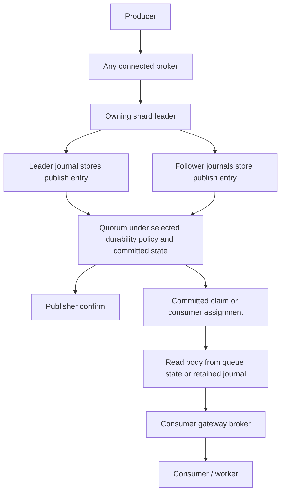

# Distributed queues

Cluster mode is opt-in and uses a replicated journal. Start with a local one-voter
broker and activate peers later, or provision one to three addressed original voters.
Each broker needs its own persistent directory. AMQP clients can connect to any enrolled
broker through that broker's application listener. Peer traffic uses a separate
listener.

## Availability

[v0.15.0](https://github.com/maxpert/strangeq/releases/tag/v0.15.0) predates
distributed queues. For the development workflow below, use an
`amqp-server` binary from the same revision as this guide.
[Source build instructions](../QUICKSTART.md#from-source)

Use a fresh data directory for Raft storage. The default startup uses
standalone storage. See [cluster behavior and limits](#behavior-and-limits)
before deploying, including the scope of the management API.

## Pilot: start locally, then activate peers

This example runs two brokers on one machine. The first broker starts as a
one-voter Raft node and can accept peers later.

### Start the first broker

Save this as `local.yaml` and choose a fresh data directory.

```yaml
network:
  address: "127.0.0.1:5672"
storage:
  path: "./local-data"
cluster:
  local: true
  shards: 32
```

```sh
amqp-server --config local.yaml
```

The broker provisions its journal and prints its cluster lineage and node ID.
Record both values for the joiner's configuration. Keep the data directory
for restarts. You can publish and consume at `127.0.0.1:5672` now.

### Create a peer token

Run this once for a new cluster. Every broker uses the same token. Distribute
it as a secret file when running on multiple hosts.

```sh
umask 077
openssl rand -base64 32 | tr -- '+/' '-_' | tr -d '=\n' > peer.token
```

### Enable peer connections

Edit `local.yaml` while the first broker is running. Append these settings
under the existing `cluster` key. Keep `local: true`, the data directory,
and the original shard and storage settings.

```yaml
  peer_address: "127.0.0.1:7661"
  token_file: "./peer.token"
  allow_loopback_plaintext: true
```

After saving, send SIGHUP to the first broker with `kill -HUP PID`, replacing
`PID` with its process ID. Peer settings take effect on port 7661. The broker
keeps its journal and existing AMQP sessions. Keep the activated configuration
and credentials for restarts. Repeating activation with the same settings is
safe. An active listener retains its credentials and certificates on reload.
For brokers on separate hosts, configure [peer TLS](#provision-an-addressed-seed).

### Join a second broker

Save this as `node-2.yaml`. Replace `SOURCE_LINEAGE` and `SOURCE_NODE_ID`
with the values printed by the first broker. Use a unique positive `node_id`
and a fresh data directory for the joiner.

```yaml
network:
  address: "127.0.0.1:5673"
storage:
  path: "./node-2-data"
cluster:
  id: "SOURCE_LINEAGE"
  node_id: 2
  peer_address: "127.0.0.1:7662"
  seeds: ["SOURCE_NODE_ID@127.0.0.1:7661"]
  shards: 32
  token_file: "./peer.token"
  allow_loopback_plaintext: true
```

```sh
amqp-server --config node-2.yaml
```

The joiner enrolls at startup. Use `--initialize-cluster` only when provisioning
original addressed voters. Publish to a queue with confirms on port 5672
and consume from the same queue on port 5673 to check routing. Subsequent
joiners use the same original seed and their own IDs, ports, and data
directories. With two voters, commits need both. Wait for three caught-up
voting replicas in the catalog and each affected shard before relying on
one-broker failure tolerance.
[Readiness and quorum](#readiness-and-quorum)

The local broker uses full durability by default. The optional `process`
profile preserves confirmed publishes and required settlements across a broker
process kill while the OS kernel remains running. Peer activation permanently
upgrades the journal to full durability.
[Process-mode recovery](#process-mode-recovery)

## Provision an addressed seed

Use this path when peer listeners should be available from the start.
[Create a peer token](#create-a-peer-token) before provisioning.

Save this local test configuration as `node-1.yaml`.

```yaml
network:
  address: "127.0.0.1:5672"
storage:
  path: "./node-1-data"
cluster:
  id: "example"
  node_id: 1
  peer_address: "127.0.0.1:7661"
  seeds: ["1@127.0.0.1:7661"]
  token_file: "./peer.token"
  allow_loopback_plaintext: true
```

Run `amqp-server --config node-1.yaml --initialize-cluster` once. It provisions the
original voter's disk and exits. Then start it with `amqp-server --config node-1.yaml`.
For two or three original voters, put the same complete `seeds` list in every
configuration, for example `["1@127.0.0.1:7661", "2@127.0.0.1:7662",
"3@127.0.0.1:7663"]`. Give each broker its own node ID, peer and AMQP addresses, and
storage directory. Initialize every original voter once before starting any of their
servers. Do not use the joining-node procedure for an original voter.

For traffic between hosts, omit `allow_loopback_plaintext` and set `peer_cert_file` and
`peer_key_file` to a certificate and key for the advertised peer address. Set
`peer_ca_file` if the certificate uses a private CA. `peer_listen` can override the bind
address while keeping the advertised address. Every peer holding the cluster credential
is trusted to participate in consensus. Keep peer clocks synchronized for request
authentication and delivery leases.

## Add a node

Keep the cluster ID, original `seeds`, shard count, and token the same. Set a new
positive `node_id`, a reachable `peer_address`, and its own storage directory. For a
second broker on the same machine, save this as `node-2.yaml`.

```yaml
network:
  address: "127.0.0.1:5673"
storage:
  path: "./node-2-data"
cluster:
  id: "example"
  node_id: 2
  peer_address: "127.0.0.1:7662"
  seeds: ["1@127.0.0.1:7661"]
  token_file: "./peer.token"
  allow_loopback_plaintext: true
```

Start it with `amqp-server --config node-2.yaml`. The broker enrolls on startup. You can
declare a queue and publish with confirms on port 5672, then consume and acknowledge
using the same queue name on port 5673. The receiving broker routes each operation to
the owning shard.

If the original seed is unavailable after the catalog has three voters, set
`cluster.discovery` to the peer addresses of reachable enrolled brokers. The immutable
`seeds` still identify the original configuration.

The membership catalog retains its first three voters after it reaches three. Online
enrollment does not replace those voters. Shards place replicas and preferred leaders
across eligible peers. A joining replica catches up as a learner before voting. As
placement converges, retired stores are removed after persisting a replica tombstone.
Never use initialization to replace a lost original voter disk. Replacement needs a new
node identity, and recovery of a lost catalog quorum is a separate operator operation.

When initializing a seed with a fresh directory, StrangeQ probes the other original
seeds and configured discovery addresses for a running cluster. A reachable enrolled
peer with the same cluster credentials blocks initialization. Unreachable peers leave
the probe inconclusive. Use initialization only for a known-new cluster and preserve the
durable identity of an existing voter.

## Configuration reference

| Key under `cluster` | Default | Purpose |
|---|---|---|
| `local` | `false` | Configured local-journal pilot: generates persistent one-voter identity on first open. Keep `true` after peer activation. |
| `id` | Empty | Enables addressed cluster mode and identifies the cluster. Local pilot startup generates this value; joiners use that same lineage. |
| `node_id` | Required for addressed peers | Unique positive node ID. Generated on first local open; preserve across restarts with the same data directory. |
| `peer_address` | Required for addressed peers | Advertised peer `host:port`. Omit for unactivated local storage; configure to activate its peer transport. |
| `peer_listen` | `peer_address` | Local bind address for peer traffic. |
| `seeds` | Required for addressed peers | One to three original voters as `node_id@host:port`. Keep the same original list on joining peers; local pilot source must omit it. |
| `discovery` | Empty | Additional peer `host:port` addresses for discovering enrolled brokers. |
| `shards` | `32` | Fixed data shard count from 1 to 1024. Use the same count on every broker. |
| `token_file` | Required with peer transport | File containing the shared 32-byte token encoded as unpadded base64url. Omit for unactivated local storage. |
| `peer_cert_file`, `peer_key_file` | Empty | PEM certificate and private key for peer TLS. Set both for multi-host deployments. |
| `peer_ca_file` | System trust roots | PEM trust roots for a private CA. |
| `allow_loopback_plaintext` | `false` | Allows peer traffic without TLS on numeric loopback addresses for local tests. |
| `experimental_raft_range_sync` | `false` | Enables Linux synchronous range writes for eligible journal appends; other platforms retain normal sync. |
| `experimental_raft_journal_dual_stream` | `false` | Uses two journal streams per node. Requires range sync; select during provisioning and retain on restart. |
| `experimental_ack_and_claim` | `false` | Combines manual acknowledgments and delivery refill in a fresh journal cluster. Incompatible with assignments; enable on every broker when provisioning. |
| `experimental_assignments` | `false` | Uses committed consumer assignments in a fresh journal cluster. Enable it on every broker when provisioning. |
| `experimental_replica_bodies` | `false` | Lets a broker reconstruct eligible remote assignment bodies from its own durable journal. Requires `experimental_assignments`. |
| `experimental_journal_body_compression` | `false` | Losslessly packs eligible 32–128 KiB bodies. Requires `experimental_assignments`. |
| `experimental_journal_small_body_compression` | `false` | Extends body compression down to 1 KiB in a fresh cluster. Requires `experimental_journal_body_compression`. |

Cluster state lives under `storage.path/cluster`. Relative paths resolve from the
working directory. Configure AMQP client authentication and encryption separately from
peer TLS. See [TLS](TLS.md) and [Authorization](AUTHORIZATION.md).

### Shared segmented journal

Configured Raft nodes always use the shared segmented journal. There is no backend
selector: `cluster.experimental_raft_journal` has been removed. Provision fresh cluster
storage directories for the segmented journal. Existing bbolt Raft stores and flat journals are
rejected, not converted. Keep the stream and format settings on subsequent restarts
because they are part of the durable node identity. Ordinary standalone mode continues
to use its existing storage engine. This release does not migrate standalone data into
Raft storage.

Streams provisioned with full durability roll into 256 MiB segments. Linux process-mode
streams use 32 MiB segments and preserve that size after activation. StrangeQ reclaims a
sealed segment after a durable checkpoint covers it and all live messages and readers
have released it. The 8 GiB journal budget counts retained segments and indexes across
all streams on a node. Cumulative appends can exceed 8 GiB as files are reclaimed.
Snapshot blobs have a separate 8 GiB budget per stream. A write that exceeds a
retained-space budget fails the affected storage path.

Set `cluster.experimental_raft_range_sync: true` to try Linux `pwritev2(RWF_SYNC)` for
nonempty durable append batches with no earlier dirty bytes. The normal journal path
handles earlier dirty data and empty barriers. An unsupported syscall or operation
(`ENOSYS` or `EOPNOTSUPP`) falls back to write-and-sync only when no bytes were written.
Short writes and other errors still stop the writer. Other platforms retain normal sync.
This option is off by default and can change on restart with the same journal. It
changes neither the disk format nor peer protocol and need not match across brokers.

Set `cluster.experimental_ack_and_claim: true` on every broker in a fresh test cluster
to enable combined manual ACK and delivery refill. Keep the setting on restart. This
mode uses a distinct storage marker and peer protocol identity so earlier brokers cannot
open its journals or join its Raft groups.

Assignments and ACK-and-claim are mutually exclusive storage modes. Select one when
provisioning a fresh cluster and keep it on every broker and restart.

Enable body compression, and optionally small-body compression, on every broker when
provisioning a fresh cluster. Keep the setting on restart. The mode has its own disk
identity and peer protocol. Packing requires a saving of at least 25%. AMQP clients
receive the original bytes, queue quotas use the original size, and publisher confirms
follow the journal's existing durability requirements.

For a cluster already using experimental assignments, set
`cluster.experimental_replica_bodies: true` to try reconstructing 32–128 KiB assignment
bodies from the receiving broker's journal. This setting can change on restart with the
same assignment journal. Older assignment peers and unavailable references use full
assignment pages with the original delivery cursor. If local body verification fails,
the broker logs the fault and stops its affected shard replica before retrying through a
healthy leader.

### Process-mode recovery

On Linux, a fresh local `process` store uses versioned recovery roots and requires a
readable, nonempty kernel boot ID. A same-kernel restart selects the live root. After a
kernel reboot, recovery selects only the last physically certified root. Missing or
unknown root versions are rejected. Earlier development roots and unrooted journals are
not converted.

Rooted stores are detected even when opened with full durability, including peer
activation recovery, and require Linux. Other platforms retain the unrooted journal
behavior. Neither behavior gives process mode a guarantee against OS crashes, host
resets, or power loss.

Before peer transport opens or its endpoint commits, activation durably records its
intent and upgrades the journal to full durability. The upgrade is one-way, including
failed attempts. Startup with peer settings or an existing activation intent opens with
full durability before recovery. Retaining `durability: process` in the configuration
cannot downgrade an activated journal.

## Readiness and quorum

With [telemetry](METRICS.md) enabled, `/health` includes the broker's cluster enrollment
status. A ready broker can still encounter a shard without quorum. Use an AMQP publish
with confirms to verify that a particular queue can accept writes. If enrollment stalls,
check reachability on the advertised peer port, the original seed list, the shared
token, and the peer certificate and CA.

Restart a broker with its existing configuration and persistent directory. If a shard
loses quorum, restore access to enough of its existing voters before expecting new
commits.

### Leader loss and client recovery

If a shard leader fails while the connected gateway and voting quorum survive, new
confirms and deliveries pause while a replacement is elected. In publisher confirm mode,
transient or ambiguous publish failures nack every affected tag while preserving the
healthy connection and channel. StrangeQ does not replay publishes whose commit outcome
is unknown. A nack in this case does not prove that no copy committed. Application
retries can duplicate messages.

Same-session recovery was verified for the default profile in three in-process
leader-shutdown checks. These checks do not establish external process-kill,
indefinite-outage or complete settlement-recovery behavior. If the client's gateway
dies, reconnect to a healthy endpoint and restore the client session. Non-confirm
publishes and fatal errors can still close a connection. Without quorum, new commits
must wait. Use publisher confirms and idempotent consumer processing, and handle
unresolved publishes and possible redelivery explicitly.

## Queue placement and metadata

Every broker hashes the queue name to the same shard ID. The replicated catalog records
broker identities, addresses, and each shard's committed replica membership. Brokers
keep a routing view in `storage.path/cluster/catalog-cache`. Each shard elects its own
leader, and brokers update their leader hints as they route requests.

StrangeQ embeds the [etcd Raft library](https://github.com/etcd-io/raft). Each
configured Raft node persists its groups' logs, term, vote, commit progress and recovery
checkpoints through the shared segmented journal, including the catalog. The broker
persists Raft updates before sending replication acknowledgments or reporting a
committed queue operation.

## How clustered messages are committed and read

Cluster mode uses the shared segmented Raft journal instead of the standalone storage
engine. A clustered publish has no additional write to the standalone queue WAL.

For an ordinary successful publish to one queue, the body is carried by one Raft log
entry and appended to the journal once on each participating replica. The leader waits
for a quorum and applies the committed command before returning success for the
publisher confirm. Each participating replica follows the selected durability policy.
addressed peers use full durability. An unactivated local broker can use `process`. The
quorum can respond while remaining followers catch up. Replication creates durable
copies on other brokers. Batching can put several messages or entries into one write, so
system call and sync counts depend on the batch.



The diagram shows the shared journal used by every configured Raft node. The
experimental two-stream option assigns even group IDs to stream 0 and odd IDs to stream
1. Each group uses one stream and writes its payload only to that assigned stream.

A worker consumes through its connected broker, which routes queue operations to the
owning shard leader.

- Without experimental assignments, a replicated claim moves a message into
  the consumer session's in-flight state before returning its body. Manual
  consumers can claim batches. ACK, requeue, and rejection are replicated
  state changes as well.
- With experimental assignments, committed queue operations assign messages
  to registered consumer sessions. The broker reads those assignments through
  a quorum-fenced leader query, or receives a page with an ACK response. Reading
  an assignment page uses the already committed payload bytes.
- Eligible stored bodies of at least 32 KiB stay as
  references into retained journal data. Smaller bodies remain in queue memory.
  Delivery encoders read and checksum the referenced bytes when needed. These
  references retain the source segments until the messages and readers release
  them.
- With `experimental_replica_bodies`, an eligible remote assignment page can
  carry verified body references instead of full bodies. If the consumer's
  broker has the matching local shard journal data, it reads the bodies there.
  The leader still authorizes the assignments. Missing or compacted references
  fall back to a full page from the leader.

"One payload-bearing append per replica" describes the ordinary single-target publish
path. Additional writes occur over a message's lifetime. Checkpoints persist complete
queue state images, including live message bodies, so a body can exist in both a
retained log segment and a checkpoint. Raft hard-state updates, membership records, and
commit progress also cause persistence. Exchange fanout publishes separately to each
destination queue. A non-requeued rejection with dead-lettering stages a durable
source-side move and publishes the body to each destination. Even a same-shard
destination publish currently carries the body again. It commits the target copy and
marks that destination complete in the source outbox atomically in one shard command. A
cross-shard destination commits its publish separately before source completion. These
destination publications and any retries are additional queue operations using the Raft
backend. See [replicated dead-lettering](DEAD_LETTERING.md#replicated-queues).

## Behavior and limits

- One voter commits to its local durable store. With two voters, both must
  respond. A three-voter shard can commit through one voter outage.
- A confirm follows a committed publish under the selected durability policy. A connection or
  leadership failure can leave the outcome unknown. AMQP publishers that retry
  after an unknown outcome should account for duplicate messages. Unsettled
  deliveries are requeued on session release or lease expiry.
- The default 32 shard count is fixed for a cluster's lifetime. A single strict
  FIFO queue runs on one shard. Multiple queues allow compute and storage work
  to spread across more brokers. The supported configuration range is 1–1024
  shards.
- Each data shard has a 48 MiB live payload budget and bounds on queues,
  messages, and sessions. Durable checkpoints retire committed log prefixes.
  sealed segments are reclaimed once no checkpoint, live body or reader needs
  them, within the shared retained-space budget described above.
- Run the same StrangeQ build on every broker. Upgrade the cluster together.
  Opening a cluster store updates its Raft storage mode so older builds cannot
  replay settlements with different dead-letter semantics.
- Cluster mode supports ordinary queue declarations, publish, get, consume,
  ack, nack, requeue, and exchange routing in the default virtual host.
  A publish routed to several queues commits separately on each destination
  shard, so an error can leave a partial fanout.
- Durable replicated queues support [at-least-once dead-lettering](DEAD_LETTERING.md#replicated-queues)
  for non-requeued consumer rejections.
- Cluster mode rejects transactions, exclusive or auto-delete queues, other
  queue policies, and named virtual hosts. Use a fresh storage directory.
  Existing standalone stores are not imported.
- Enable the [cluster Nodes panel](MANAGEMENT.md#cluster-administration) to
  inspect local Raft observations. The [three-node demo](../src/amqp-go/examples/cluster-demo/README.md)
  includes controls for the broker processes it starts.
